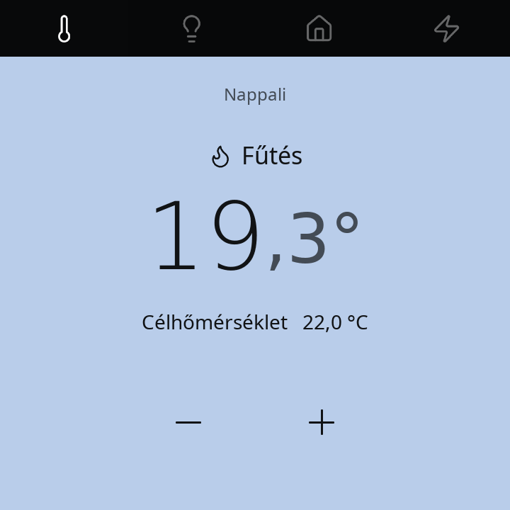
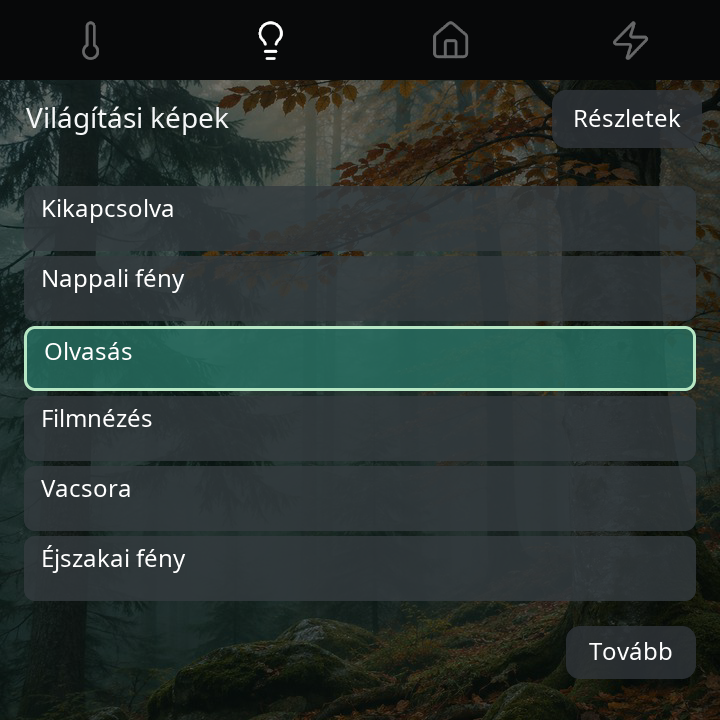
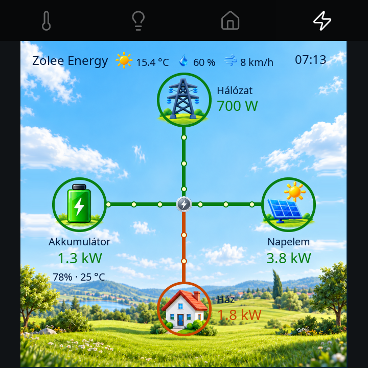

# ZoleeLoxoneDisplay

  
  

Négyhüvelykes szobai érintőkijelző Loxone Miniserverhez. A **Waveshare ESP32-P4-WIFI6-Touch-LCD-4B (SKU 31416)** és a **Waveshare ESP32-P4-WIFI6-Touch-LCD-4B-ETH-2RO (SKU 31570)** panelekre készült. A gyártó a második típust **ESP32-P4-86-Panel-ETH-2RO** néven is jelöli.

A felső ikonsorral válthatsz a szoba világítása, hőmérséklete, árnyékolása vagy akár a ház energiaáramlása között. A fülek sorrendjét és tartalmát a kijelző saját, magyar nyelvű webes felületén szerkesztheted. A panel közvetlenül a Miniserverhez csatlakozik. A működéshez FAT32-es microSD-kártya szükséges.

| Helyiségklíma | Világítási képek | Energiaáramlás |
| --- | --- | --- |
|  |  |  |

A három előnézetet a firmware saját LVGL-felülete rajzolta mintaadatokkal. [Kijelzőképek és érintési műveletek](docs/screens.md)

## Első bekapcsolás

1. Azonosítsd a cikkszámot és az ESP32-P4 **v1.x vagy v3.x** szilíciumrevízióját. Az adott profil **USB** képét írd a panelre, majd helyezd be a microSD-kártyát. [Bináris kiválasztása és USB-telepítés](docs/hardver-es-forditas.md)
2. Válaszd ki a Wi-Fi-hálózatot és írd be a jelszót a panel érintőbillentyűzetén. A 31570-et Etherneten is csatlakoztathatod. Nyisd meg böngészőben a kijelzőn megjelenő IP-címet.
3. A **Frissítés** oldalon a **Képcsomag letöltése az SD-kártyára** gomb telepíti a firmware-hez tartozó fájlokat. Internet nélküli helyi hálózaton az USB-kép mellé kiadott `.zld` csomagot válaszd ki a számítógépen. [Első telepítés és későbbi frissítés](docs/frissites.md)
4. A **Miniserver** fülön mentsd a kapcsolatot, majd töltsd be az adatlistát. A **Lapfülek** alatt válassz ikont, hátteret és legalább egy megjeleníteni kívánt vezérlőt. Mentés után a kijelző átveszi a módosításokat. [Webes beállítások](docs/web-config.md)

## Mit tehetsz egy fülre?

| Nézet | Kezelés |
| --- | --- |
| Világítás | Egyetlen világításvezérlő a teljes lapot megkapja. A hangulatlistában látható az aktív világítási kép. A részleteknél a kapcsolható, dimmelhető és RGBW-kimeneteket is elérheted. |
| Helyiségklíma és árnyékolás | Nagy mért hőmérséklet, célhőfok és félfokos állítás. Az árnyékolónál fel, stop, le és az adott blokk által támogatott pozícióállítás. |
| Több eszköz egy lapon | A sorokból megnyitható az adott eszköz kezelőfelülete. Kapcsoló, nyomógomb, dimmer, érték, csúszka, időzített kapcsoló, ajtó–ablak összesítő, kapu, motoros ablak és modern Audioserver is hozzárendelhető. |
| Energiaáramlás | A négyzetes 4B Slave nappali és éjszakai ábrája a hálózat, az akkumulátor, a napelem és a ház közötti áramlást mutatja. A jelek az adott energiafülhöz rendelhetők. |
| Kaputelefon | Csengetéskor a panel megmutatja az élőképet és a beszélgetés gombját. Beállított kimenet esetén a kapu is nyitható. A kaputelefon bekapcsolása és a média használata külön lépés, a nagy pufferek híváskor foglalódnak le. |

**Megjelenés.** Nyolc fület állíthatsz össze, vezérlőfülenként legfeljebb tizenkét elemmel. A fülikonokhoz 84 monokróm piktogram, a szobahátterekhez grafikus színválasztó és 32 képes miniatűr áll rendelkezésre. A képtárban balatoni és dunakanyari ihletésű tájak, valamint eltérő színvilágú grafikák is vannak. [Háttérképek és ikonok előnézete](docs/keptar.md)

**Éjszakai használat.** Az éjszakai fényerőt Miniserver-jel vagy helyi időzítés kapcsolja. Ettől függetlenül beállítható az inaktivitási idő. Ha letelik, nagy óra és halvány fülsor jelenik meg. Az első érintés felébreszti a panelt. Az időkorlát üresen hagyva vagy nullára állítva kikapcsolja az automatikus képernyőkímélőt.

## Dokumentáció

| Útmutató | Tartalom |
| --- | --- |
| [Kijelző és érintéses kezelés](docs/screens.md) | Teljes lapos vezérlés, napi energiaösszesítő és képernyőkímélő |
| [Hardver és fordítás](docs/hardver-es-forditas.md) | Cikkszámok, szilíciumrevíziók, build és első USB-telepítés |
| [Frissítés és helyreállítás](docs/frissites.md) | Egygombos képtelepítés, kötelező SD-ellenőrzés, megszakított OTA |
| [Miniserver](docs/miniserver.md) | Hitelesítés, struktúra, állapotok, parancsok és kapcsolatvesztés |
| [Helyi konfiguráció](docs/web-config.md) | Oldalszerkesztő, blokkok, háttér, érték-hozzárendelések és éjszakai profil |
| [Kaputelefon](docs/kaputelefon.md) | Gen2 MJPEG, SIP/RTP, csengőhang és kapunyitás |
| [Képtár](docs/keptar.md) | Mind a 32 háttér és 84 ikon, képformátumok és források |
| [Fejlesztési terv](docs/fejlesztesi-terv.md) | Mérföldkövek és valós készüléken elvégzendő próbák |

A projekt első fejlesztési ága az **INIT**. A firmware és az SD-csomag profil szerinti párokban érhető el a sikeres fordítások mellékletei között. A hardverleírás a Waveshare adataira épül, a kezelési minta a Loxone Touch Pure Displayt követi. A banner projekthez készült látványterv.

[GitHub Actions](https://github.com/ZoleeBB/ZoleeLoxoneDisplay/actions/workflows/firmware.yml) · [Forrásprojekt](https://github.com/ZoleeBB/ZoleeEnergyFlowDisplay) · [Waveshare hardverleírás](https://docs.waveshare.com/ESP32-P4-WIFI6-Touch-LCD-4B) · [Loxone Touch Pure Display](https://www.loxone.com/int/products/control-elements/touch-pure-display/)
