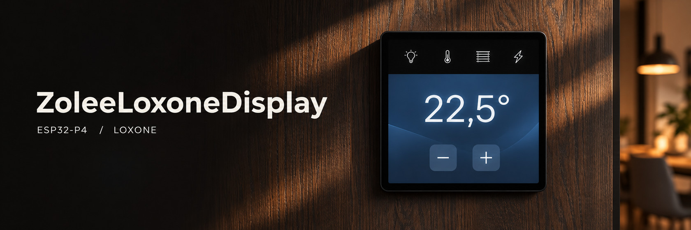

# ZoleeLoxoneDisplay

  
  

Négyhüvelykes szobai érintőkijelző Loxone Miniserverhez. A projekt a **Waveshare ESP32-P4-WIFI6-Touch-LCD-4B (SKU 31416)** és a **Waveshare ESP32-P4-WIFI6-Touch-LCD-4B-ETH-2RO (SKU 31570)** panelekhez készül. A gyártó a második típust **ESP32-P4-86-Panel-ETH-2RO** néven is jelöli.

A helyi webes felületen megadható, mely világítások, árnyékolók és helyiségszabályozók kerüljenek az egyes fülekre. Az eszköz közvetlenül a Miniserverhez kapcsolódik. A képkészlethez microSD-kártya szükséges.

[Fejlesztési terv és készülékes próbák](docs/fejlesztesi-terv.md) · [Forrásprojekt](https://github.com/ZoleeBB/ZoleeEnergyFlowDisplay) · [Waveshare hardverleírás](https://docs.waveshare.com/ESP32-P4-WIFI6-Touch-LCD-4B) · [Loxone Touch Pure Display](https://www.loxone.com/int/products/control-elements/touch-pure-display/)
