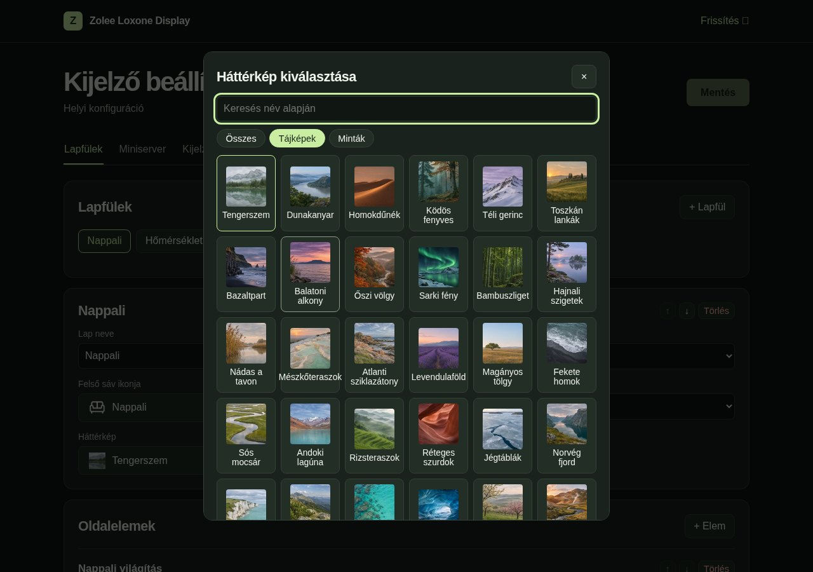
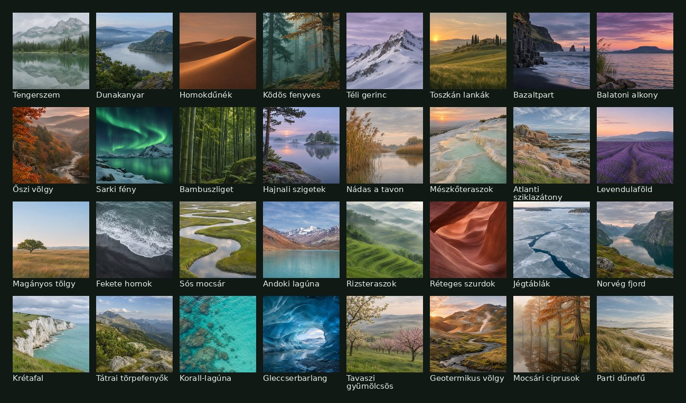
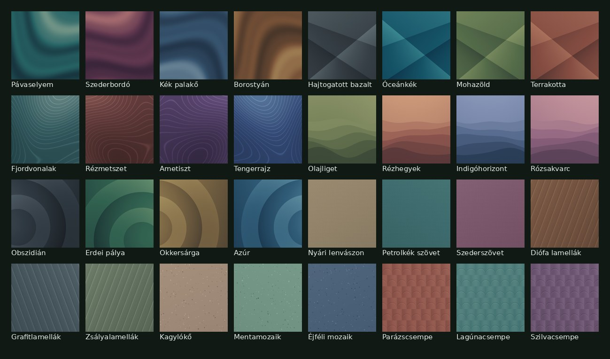
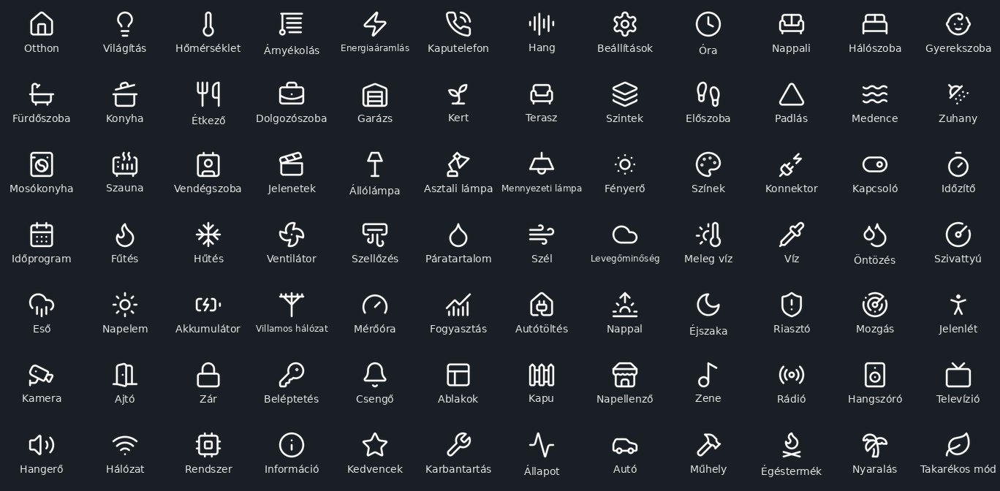

# Háttérképek és fülikonok

A webes szerkesztőben nyisd meg a kívánt szobafület. A **Háttér típusa** mezőben az **Egyszínű** lehetőséggel színt választhatsz, a **Háttérkép** lehetőséggel pedig megnyithatod a miniatűrökből álló képtárat. A fülikon külön választható. Az energiafül saját nappali és éjszakai grafikát használ.

A háttérválasztó **Tájképek** és **Minták** szűrőjével külön is böngészheted a két gyűjteményt. Az **Összes** mind a 64 hátteret mutatja. A kereső a kiválasztott kategórián belül keres a magyar nevekben és az azonosítókban.

## 32 tájkép

A fotószerű tájillusztrációk között vízpartok, hegyi látképek, erdők és dűnék szerepelnek. A képek 720 × 720 képpont méretűek. A képtáblán a webes szerkesztőben használt magyar nevek szerepelnek. [A tájképek eredete és képkivágása](../tools/visuals/landscape-production.md)

## 32 mintás háttér

A selyem, hajtogatott, szintvonalas, dombos és köríves grafikákat vászon-, lamella-, terrazzo- és csempeminták egészítik ki. Az **Egyszínű** mezőben a mentett mintákon túl egyedi színárnyalatot is választhatsz.

## A 84 ikon

A fülekhez helyiséget, Loxone-funkciót vagy berendezést jelölő piktogramot választhatsz. A fehér vonalrajz átlátszó hátterű, így ugyanaz a fájl az aktív és a halványított állapothoz is használható.

## Az SD-csomag felépítése

| Fájl | Tartalom |
| --- | --- |
| `sdcard/catalog.json` | A beállításokban tárolt stabil azonosítók, magyar feliratok, háttérkategóriák és miniatűrútvonalak |
| `sdcard/backgrounds/<id>.jpg` | 720 × 720 képpontos, háromcsatornás baseline JPEG |
| `sdcard/thumbs/<id>.jpg` | 120 × 120 képpontos webes előnézet |
| `sdcard/icons/<id>.png` | 64 × 64 képpontos RGBA ikon |
| `sdcard/licenses/` | Az ikoncsomag licencei |

A bannert és a fotószerű tájillusztrációkat ehhez a projekthez generáltuk. A banner látványterv. A színes minták a projekt saját grafikái. Az ikonok a Lucide 0.468.0 kiadásból származnak, a csomag a Lucide és a benne használt Feather-elemek licenceit is tartalmazza. [Lucide 0.468.0](https://github.com/lucide-icons/lucide/tree/0.468.0)

### Képtár újragenerálása fejlesztéskor

A következő műveletek az adattár gyökeréből futtathatók. Mindegyikhez elegendő a forráscsomag, az eszköz futás közben az SD-kártyán található képeket használja.

1. A színminták forrása és paraméterei a `tools/visuals/palettes.py` fájlban találhatók. A `python tools/visuals/palettes.py` parancs Pillow és NumPy segítségével előállítja a 32 teljes méretű grafikát.
2. Új fotószerű háttérhez helyezd a 720 × 720 méretű baseline JPEG-et a `sdcard/backgrounds/` mappába, majd add meg az azonosítóját és a magyar nevét a `tools/visuals/landscapes.tsv` fájlban.
3. Az ikonok Lucide-forrásneveit a `tools/visuals/icons.tsv` rögzíti. Átalakításukhoz a `node tools/visuals/icons.cjs /útvonal/lucide-0.468.0` parancs használható a `sharp` Node-csomaggal.
4. A `python tools/visuals/catalog.py` újraépíti a miniatűröket és a magyar képtárat. A tájképek a `landscape`, az algoritmikusan rajzolt hátterek a `pattern` kategóriába kerülnek. A meglévő azonosítókat tartsd meg, mert a mentett oldalak ezekre hivatkoznak.
5. A `python tools/visuals/gallery.py` elkészíti a fenti két névvel feliratozott képtáblát. Ehhez Pillow és a DejaVu Sans betűkészlet szükséges.
6. A `python tests/test_visual_assets.py` ellenőrzi a katalógust, a két kategória elemszámát, az útvonalakat, a képméreteket és a fájlformátumokat.
