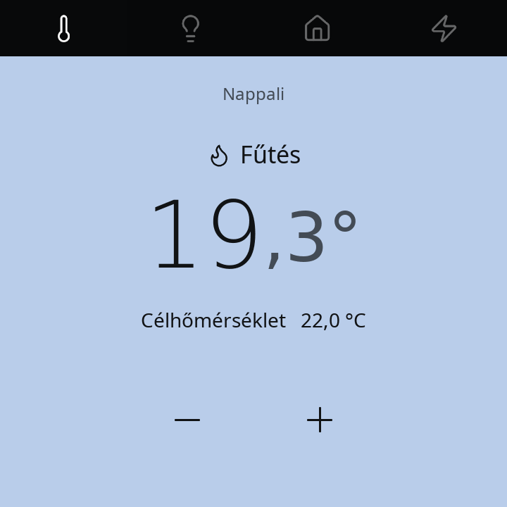
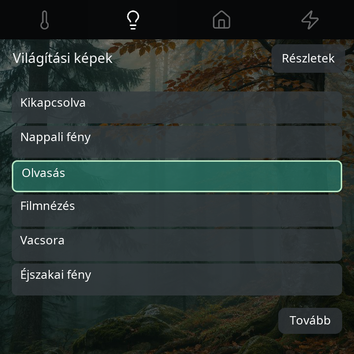
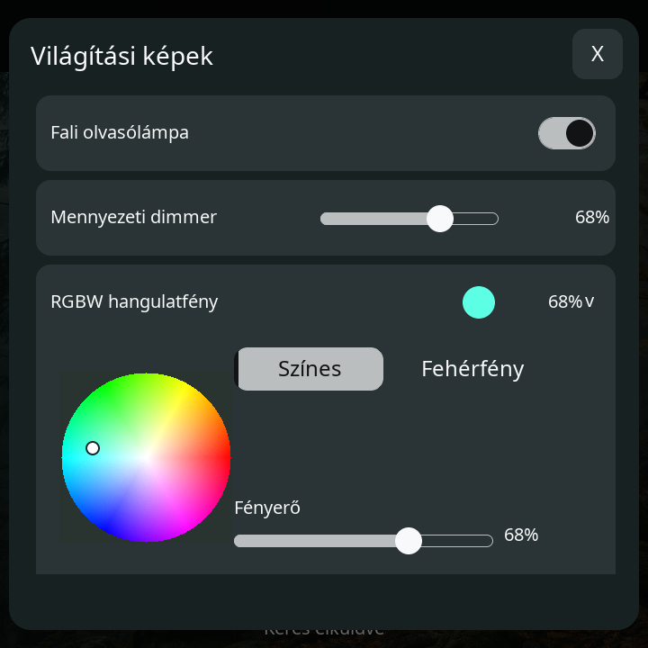
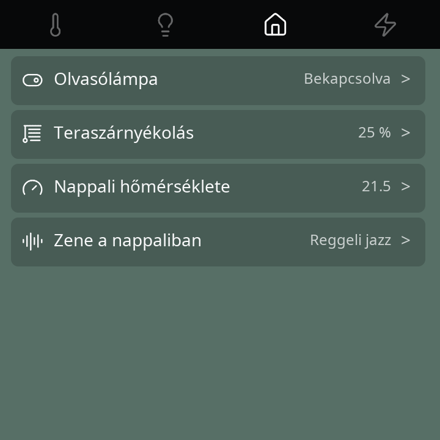
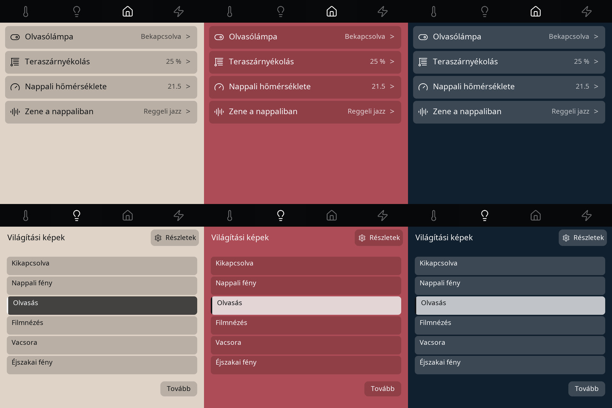
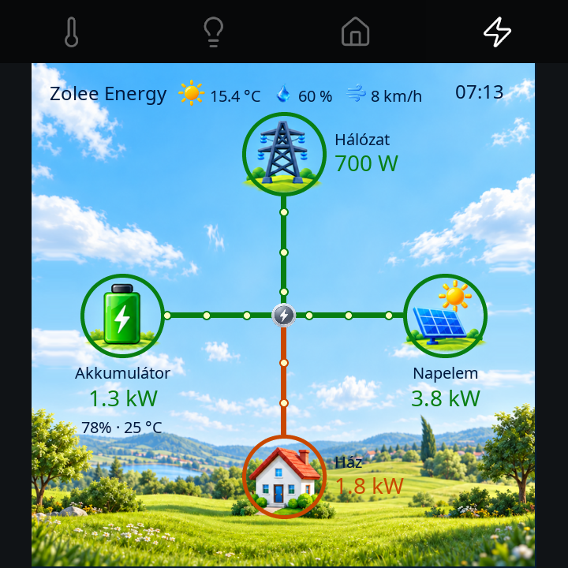
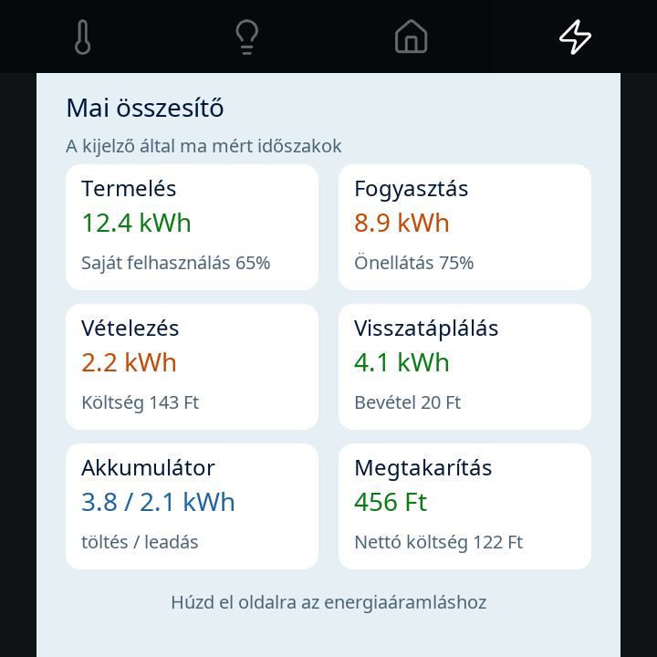
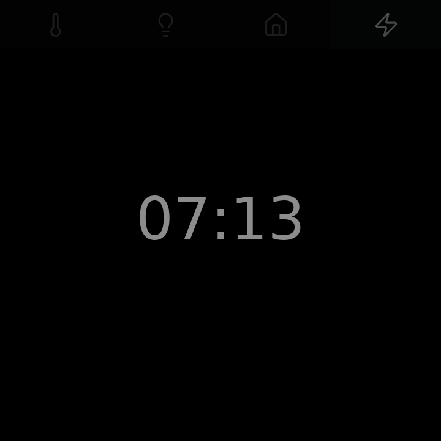
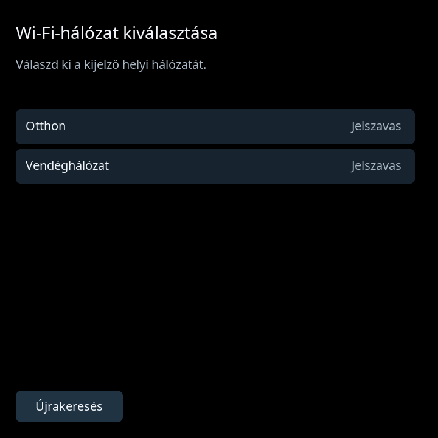
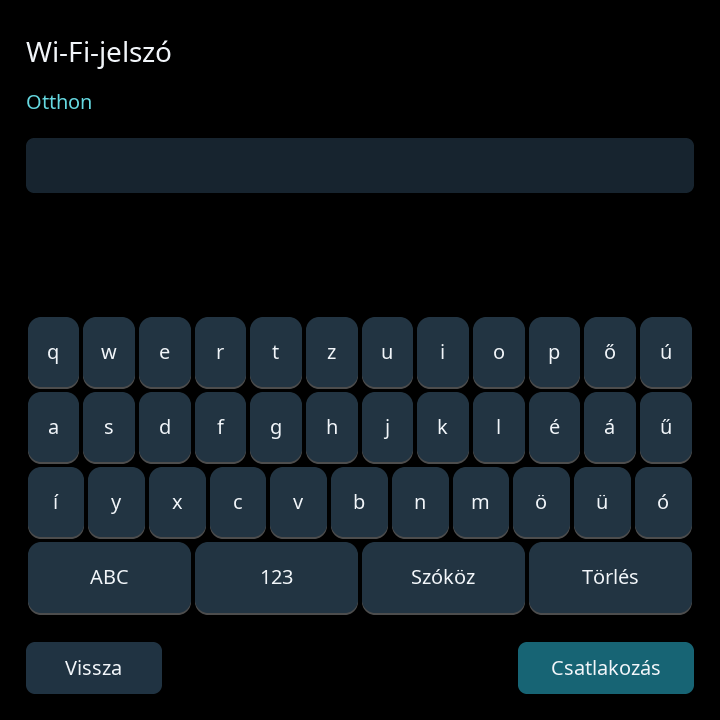

# A kijelző használata

A felső ikonsoron érintsd meg a kívánt helyiséget vagy funkciót. Hat vagy több lapnál húzd oldalra az ikonsort. A helyiséglistában megérintett sor megnyitja az adott vezérlőt. A bal felső visszanyíllal visszaléphetsz a listára. Egyetlen blokk esetén a teljes lap rögtön annak kezelésére nyílik meg.

| Szobatermosztát | Világítási képek |
| --- | --- |
|  |  |
| A középső szám a mért hőmérséklet. A két gombbal 0,5 °C-onként állíthatod a célértéket. | A kiemelés a Miniservertől kapott aktív állapotot mutatja. Egy sor érintése a hozzá tartozó világítási képet kapcsolja. |

| Világítási kimenetek | Többelemű lap |
| --- | --- |
|  |  |
| A **Részletek** megnyitja az egyes köröket. Az RGBW-sor megérintésével válthatsz színtárcsa és fehérfény között. | A kapcsolók, mért értékek, redőnyök és zenelejátszók közös lapra helyezhetők. |

A világítási lista egyszerre hat hangulatot mutat. A többi az **Előző** és a **Tovább** gombbal érhető el. A részletes kimenetkezelő a tényleges körök alapján kínál kapcsolót, fényerőt, színt vagy színhőmérsékletet. A színtárcsa a részletes nézettel együtt szabadul fel. A kapcsoló, az időzített kapcsoló, a redőny, a motoros ablak és a kapu a blokk visszajelzését és a parancshoz tartozó jogosultságot követi.

A webes szerkesztőben legfeljebb nyolc lapot készíthetsz, normál laponként tizenkét elemmel. Ugyanitt választhatod ki a fülikont és az oldal háttérképét vagy alapszínét. Egyszínű oldalon a sorok és a kezelőmezők a háttérből képzett árnyalatot kapnak. Az alábbi képen a homokszínű és a mályva lapon sötétebbek a mezők, az éjkék lapon világosabbak. A feliratok színét a panel a mező fényességéhez igazítja. [Webes beállítások](web-config.md)

## Energiaáramlás és mai összesítő

| Pillanatnyi áramlás | Mai összesítő |
| --- | --- |
|  |  |

Az energiafül saját értékpárosításokat használ. A háttér, az energiautak, a csomópontok és az időjárási ábrák az eredeti négyzetes Slave nézetből származnak. Az ábra a 80 képpont magas ikonsor alatti 640 × 640 képpontos négyzetbe kerül. A nyilak szerepét a mozgó pontok látják el. Sebességük 7 kW-ig nő, irányuk a teljesítmény előjelét követi. Az értékek abszolút értékként jelennek meg, 1 kW alatt wattban, fölötte kilowattban. Szigetüzemben a hálózati út áll. A hiányzó mérés gondolatjellel látható. [A kiinduló 4B megvalósítás](https://github.com/ZoleeBB/ZoleeEnergyFlowDisplay/blob/6786e8428c42d28fe43ba0765eb3748c125ed645/firmware/slave-waveshare-4b/ui/slave_4b_ui.c)

Az ábrán végzett vízszintes húzás a **Mai összesítő** hat kártyájához vezet. Ugyanezzel a gesztussal térhetsz vissza. A kijelző akkor is gyűjti a párosított teljesítményeket, amikor más lapot nézel vagy a képernyőkímélő aktív. A napi összesítő a működés közben megfigyelt időszakokat tartalmazza. A kapcsolat megszakadása, időugrás és mintavételi rés megszakítja az integrálást. Az ismert adatok kapcsolathiba alatt is megtekinthetők.

A pénzügyi becslés az elődprojekt induló díjaival, **65 Ft/kWh vételi árral és 5 Ft/kWh betáplálási árral** készül. A megtakarítás a helyben felhasznált nap- és akkumulátorenergiát, valamint a visszatáplálás bevételét veszi figyelembe. Hiányzó mérésnél az érintett kártya üres értéket jelez. Az SD-kártyán két váltott ellenőrzőpont őrzi a napi adatokat ötpercenként. Áramkimaradással az utolsó mentés utáni percek elveszhetnek. A mérések helyi éjfélkor új napot kezdenek. A lap átrendezése megőrzi az azonos forrás értékeit, a teljesítményforrás vagy lépték átállítása új gyűjtést kezd.

## Éjszakai fényerő és képernyőkímélő

A nappali és az éjszakai fényerő külön állítható. Az éjszakai mód kezdő és befejező időponttal vagy Miniserver-értékkel vezérelhető. Az időzítő a budapesti helyi időt és az óraátállást követi. A **képernyőkímélő** ettől független. A megadott tétlenségi idő után lekapcsolja a vezérlőket, éjszakai fényerőt választ és nagy, félkövér órát jelenít meg. Alul a „Zolee LOXONE Display” felirat látható. Középen az eredeti LOXONE logó a szomszédos két szó színét kapja. Az első érintés visszahozza az előző lapot. Nulla másodperc kikapcsolja az automatikus képernyőkímélőt. A bejövő kapucsengés felébreszti a kijelzőt.

## Első bekapcsolás

| Hálózatválasztás | Jelszó | Webes folytatás |
| --- | --- | --- |
|  |  |  |

A panel FAT32-es microSD-kártyával indul. Wi-Fi esetén válaszd ki a hálózatot, majd add meg annak jelszavát. A 31570-es panel vezetékes hálózattal is folytathatja a beállítást, ha már kapott IP-címet. A képernyőn látható címet ugyanazon a hálózaton nyisd meg a böngészőben. Telepítsd a képcsomagot, állítsd be a Miniservert, majd hozz létre egy lapot. [Firmware- és képcsomagfrissítés](frissites.md)

A képek a firmware valódi LVGL 9.5.0 rajzolójából készültek. A hálózati mérési értékeket a reprodukálható szimulátor szolgáltatta. A háttérképek és ikonok az induló SD-csomag eredeti fájljai. [Szimulátor és ellenőrzés](../simulator/README.md)
