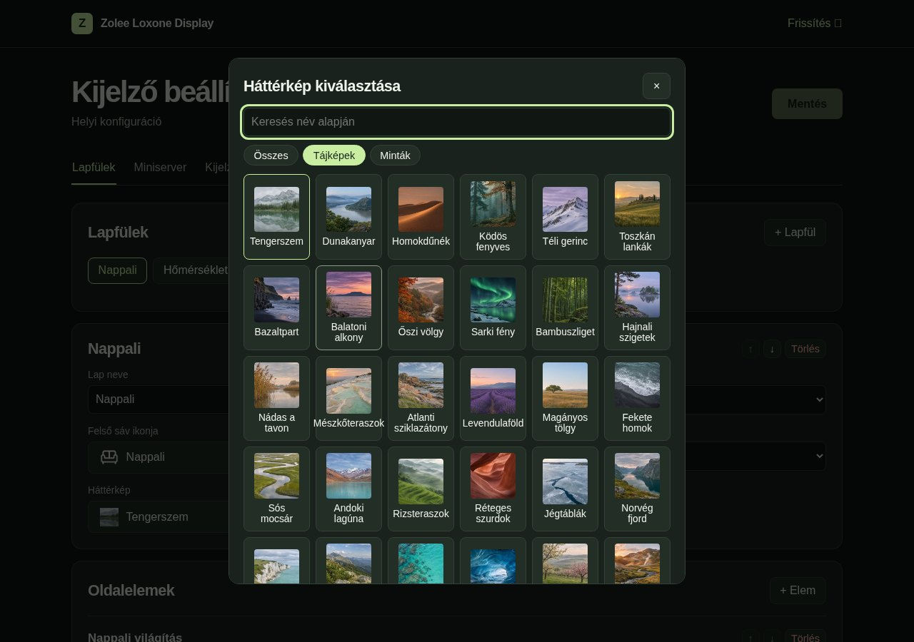

# Beállítás a kijelző webfelületén

A hálózathoz csatlakozott panel a saját IP-címét mutatja. Nyisd meg ezt a címet egy böngészőben ugyanazon a helyi hálózaton. A felület magyar nyelvű, a kijelző szolgálja ki. A **Mentés** gomb egyszerre menti az összes lapfülön elvégzett módosítást.

## Első használat

1. A **Frissítés** oldalon telepítsd a képcsomagot a FAT32 microSD-kártyára. Ha még nincs csomag, a színválasztó és a Miniserver-kapcsolat már beállítható. Az ikonok és a miniatűrök a csomag telepítése után jelennek meg.
2. A **Miniserver** fülön írd be a helyi gépnevet vagy IPv4-címet, a portot, valamint a Loxone-felhasználó nevét és jelszavát. A felhasználónak legyen hozzáférése a használni kívánt objektumokhoz. TLS-nél add meg a kiszolgálót hitelesítő CA-tanúsítványt PEM formátumban. A címhez csak a gépnév vagy IP-cím tartozik, az `http://` előtagot és az útvonalat hagyd el.
3. Mentsd a kapcsolatot. Az **Adatlista frissítése** beolvassa a Miniserver aktuális struktúráját. Loxone Configban végzett blokkátnevezés vagy új blokk felvétele után ismét futtathatod. A választó a helyiség, az objektum és az állapot nevével segíti a hozzárendelést. A közvetlen UUID-beírás is használható.
4. A **Lapfülek** részen vegyél fel egy lapot, szerkeszd a tartalmát, majd ments. A kijelző az SD-mentés után veszi át az új beállításokat.

## Lapok és kezelőszervek

Legfeljebb nyolc lap rendezhető sorba. A **Lapfül** gombbal létrehozott lap nevet és fülikont kap. Az **Okosotthon** laphoz a színválasztóval egyszínű hátteret állíthatsz be, vagy választhatsz a 32 tájkép és a 32 egyszerű minta közül. Egyszínű háttérnél a panel a mezők színét is ebből az árnyalatból számítja. A világosabb alapszíneket sötétíti, a nagyon sötéteket világosítja. Egy ilyen lapon legfeljebb 12 elem helyezhető el. A fel/le nyilak a kijelzőn látható sorrendet módosítják. A törléshez és egy tartalommal rendelkező lap típusváltásához a szerkesztő megerősítést kér. [Képtár és fülikonok](keptar.md)

Egyetlen elem teljes lapos kezelőnézetet kap. Több elemnél listából nyithatod meg a kívánt vezérlőt. A választó a funkcióhoz használható típusokat kínálja a Miniserver adatlistájából.

| Elem | Hozzárendelés |
| --- | --- |
| Mért érték | Állapot-UUID, mértékegység, szorzó, eltolás és tizedesjegyek |
| Nyomógomb, kapcsoló | Vezérlőobjektum. Kapcsolónál az `active` visszajelzés külön is megadható |
| Világításvezérlés | LightControllerV2 blokk. A kijelző a hangulatokat és a blokk kimeneteit a struktúrából olvassa |
| Termosztát, árnyékolás | Szobaszabályozó, egyedi vagy központi árnyékoló blokk |
| Dimmer, központi világítás, csúszka, időzített kapcsoló | A megfelelő blokk. Időzített kapcsolóhoz külön engedélyezhető a tartós bekapcsolás |
| Ajtó–ablak összesítő, kapu, motoros ablak | A megfelelő felügyelő- vagy vezérlőblokk |
| Audioserver | A modern Audioserver támogatott lejátszóblokkja |

A parancscél UUID-je a vezérlőobjektumhoz tartozik. Az állapot UUID-je az élő visszajelzést azonosítja. A katalógusból választva a kapcsoló `active` visszajelzése automatikusan kitöltődik, ha a struktúra tartalmazza.

## Energiaáramlás

Válaszd az **Energiaáramlás** laptípust. A hozzárendelések ennek a lapnak a beállításaiban jelennek meg. A nappali és éjszakai 720 × 720-as ábrát a panel az SD-csomagból tölti be. Az ikon továbbra is szabadon választható.

| Mező | Jelentés |
| --- | --- |
| `PowerGrid` | Hálózati kW, pozitív vételezés |
| `PowerBat` | Akkumulátor kW, pozitív kisütés, negatív töltés |
| `PowerPV`, `PowerFull` | Napelemtermelés és a ház fogyasztása kW-ban |
| `SocBat`, `Status` | Akkumulátor töltöttsége százalékban és az energiarendszer 1–5 állapotkódja |
| `BatteryTemperature`, `Temperature`, `RelativeHumidity` | Akku- és külső hőmérséklet °C-ban, relatív páratartalom százalékban |
| `WindSpeed`, `HasSunRadiation`, `HasPrecipitation` | Szél km/h-ban, napsütés és csapadék 0/1 jelként |
| `SunAzimuth`, `SunAltitude`, `Sunrise`, `Sunset` | Nappozíció fokban, napkelte és napnyugta percekben éjféltől |

Válassz minden használt méréshez egy Loxone-állapotot, majd add meg a szorzót és az eltolást. Wattban érkező teljesítményhez a szorzó `0.001`, az eltolás `0`. A hiányzó hozzárendelés üresen maradhat.

## Éjszakai profil és képernyőkímélő

A **Kijelző** fülön külön állítható a nappali és az éjszakai fényerő 1–100% között. Az éjszakai módot helyi kezdő- és végidő, illetve Loxone-állapot vezérelheti. Időzítéshez a készülék a Budapest szerinti helyi időt használja.

A **Képernyőkímélő késleltetése** az utolsó érintéstől számított másodperc. Üres mező vagy `0` kikapcsolja. Pozitív értéknél a panel az éjszakai fényerőre vált, félkövér órát, halványított fülikonokat és egyszínű alsó márkafeliratot mutat. Az első érintés visszahozza az aktív lapot.

A **Kaputelefon** fülön a **Csengőhangcsomag letöltése** gombbal telepítheted a Zolee Energy Flow Display projekt hangjait. A panel internetkapcsolatot használ, a fájlokat az SD-kártyára menti. A műveletet kikapcsolt kaputelefon mellett is elindíthatod. Ha a panel csak a helyi hálózatot éri el, nyisd meg a **Helyi ZIP telepítése** szakaszt, válaszd ki a már letöltött `*-ringtones.zip` fájlt, majd nyomd meg a **ZIP feltöltése** gombot. A csomag tömörített és kibontott mérete egyaránt legfeljebb 8 MiB lehet. A böngésző mutatja az átvitel előrehaladását, majd a panel ellenőrzésének eredményét. A telepítés után válassz hangot a **Csengőhang** listából. A **Hangminta ezen az eszközön** a böngészőt futtató telefonon vagy számítógépen szólal meg. Hallgasd meg a kiválasztott hangot, majd a panelhez a **Mentés** gombbal rögzítsd. Az alapértelmezett jelzés **Csőharang**, a **Néma** opció elnémítja a csengetést. A kapunyitás, a videó és a hang beállításai a [kaputelefon útmutatójában](kaputelefon.md) találhatók.

## Mentés és hozzáférés

A **Miniserver → Webes hozzáférés** alatt külön felhasználónévvel és jelszóval védheted a konfigurációt és a frissítést. A panel a helyi HTTP-szerveren Basic Auth hitelesítést használ. Üres adminisztrátori felhasználónévvel a helyi hálózatról bejelentkezés nélkül érhető el. A Miniserver TLS-beállítása a panel és a Miniserver közötti kapcsolatra vonatkozik.

A jelszavakat a panel AES-GCM-mel titkosítva menti az SD-re. Az eszközkulcs belső NVS-ben marad. A webfelület mentett jelszót nem jelenít meg. A jelszómező üresen hagyása megtartja a korábban megadott jelszót ugyanahhoz a címhez és fiókhoz. Másik gazdagép, TLS-beállítás vagy felhasználónév esetén add meg az új jelszót.

A `panel.json` fájl az aktív profil, a `panel.json.bak` az előző érvényes példány. A mentés ideiglenes fájl kiírásával és szinkronizálásával kezdődik. Hibás elsődleges fájlnál a panel induláskor a mentett előző változatot próbálja betölteni. Ha a két meglévő fájl egyike sem olvasható vagy másik készülékről származó hitelesítési kulcsot igényelnek, a panel helyreállítási üzenetet mutat. A kártya mentése után állítsd vissza az eszközhöz tartozó működő profilt, vagy új beállításhoz távolítsd el mindkét profilfájlt és indítsd újra.

Két megnyitott böngésző esetén egy régebbi revízió mentését a szerver elutasítja. Töltsd újra az oldalt, ellenőrizd az időközben mentett értékeket, majd ismételd meg a módosítást.
